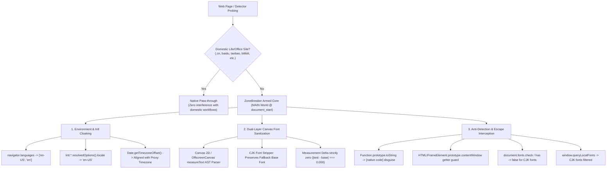

# ZoneBreaker (ZB) - 破界者 ⚡

<p align="center">
  
</p>

<p align="center">
  <strong>Next-Generation Stealth Browser Cloaking & Anti-Risk-Control Chrome Extension (Manifest V3)</strong><br>
  下一代浏览器底层无痕环境伪装与高精度风控防御插件
</p>

<p align="center">
  <a href="#english">English</a> • <a href="#chinese">中文说明</a>
</p>

<p align="center">
  
  
  
  
  
  
</p>

---

<a name="english"></a>
## 🌐 English

### Overview

**ZoneBreaker (ZB)** is an advanced anti-fingerprinting, zero-isolation browser environment cloaking extension designed to counter modern high-precision risk control models, fraud detection systems, and geographic anti-bot shields (such as those employed by Anthropic Claude, OpenAI ChatGPT, Perplexity, CreepJS, and BotD).

Traditional extensions fail because they only operate in isolated content script worlds or modify a few superficial HTTP headers. **ZoneBreaker** executes inside Chrome's **MAIN World** at `document_start`, providing deep prototype patching with native `Function.prototype.toString` disguise, dynamic Canvas text-measurement sanitization, and automatic Proxy GeoIP timezone alignment.

---

### 🌐 Supported Browsers & Compatibility

ZoneBreaker is natively built and verified across modern Chromium and Gecko browsers:

| Browser Family | Browser Name | Supported Version | Recommended Package | Compatibility Status |
| :--- | :--- | :---: | :--- | :---: |
| **Chromium** | **Google Chrome** | v102+ | `.crx` / `.zip` | 🟢 100% Full Support |
| **Chromium** | **Microsoft Edge** | v102+ | `.crx` / `.zip` | 🟢 100% Full Support |
| **Chromium** | **Brave Browser** | v1.40+ | `.crx` / `.zip` | 🟢 100% Full Support |
| **Chromium** | **Arc Browser** | All versions | `.zip` (Unpacked) | 🟢 100% Full Support |
| **Chromium** | **Vivaldi** | v5.3+ | `.crx` / `.zip` | 🟢 100% Full Support |
| **Chromium** | **Opera / Opera GX** | v88+ | `.crx` / `.zip` | 🟢 100% Full Support |
| **Gecko** | **Mozilla Firefox** | v109+ / Dev / Nightly | `.xpi` | 🟢 Full Support (`about:debugging` / Dev) |
| **Gecko** | **Floorp / Librewolf / Waterfox** | Modern MV3 | `.xpi` | 🟢 Full Support |

---

### 📦 Release Packages: Which File Should You Download?

Head to [Releases](https://github.com/kts-kris/ZoneBreaker/releases) and choose the package built for your browser:

* **`ZoneBreaker_v1.0.0.crx`**: Standard Chromium offline installation package for **Google Chrome, Microsoft Edge, Brave, Vivaldi, Opera**. Drag and drop into the extension manager to install.
* **`ZoneBreaker_v1.0.0.zip` (or `_chromium.zip`)**: Universal unpacked zip archive. Unzip and click "Load unpacked" in any Chromium browser (including **Arc Browser**).
* **`ZoneBreaker_v1.0.0_firefox.xpi`**: Specialized Gecko package for **Mozilla Firefox, Firefox Developer Edition, Nightly, Floorp, Librewolf**.
* **`SHA256SUMS.txt`**: Cryptographic integrity checksums for verification.

---

### 🛡️ The 10 Defense Vectors

ZoneBreaker achieves a **100% Pass Rate (0 Risk Score)** across all 10 critical browser detection vectors:

| # | Detection Vector | Weight | Original Leak Signature | ZoneBreaker Cloaking Defense |
| :-: | :--- | :---: | :--- | :--- |
| **1** | **System Timezone** | 24 | `Intl.DateTimeFormat` reveals `Asia/Shanghai` | Deep prototype hook spoofing target IANA timezone (e.g., `America/Los_Angeles`) |
| **2** | **Browser Language** | 18 / 24 | `navigator.languages` contains `zh-CN, zh` | Native getter rewrite + dynamic `Accept-Language` header normalization to `en-US, en` |
| **3** | **Installed Chinese Fonts** | 14 / 20 | Canvas `measureText` detects PingFang SC, YaHei, etc. | AST-level font sanitizer strips CJK families, making test widths match fallback base fonts identically |
| **4** | **Vendor Fonts** | 10 | Canvas detects MiSans, HarmonyOS Sans, OPPO Sans, etc. | Stripped dynamically with zero delta (`diff === 0.000`) against fallback monospace/sans-serif |
| **5** | **WebRTC Private IP Leak** | 10 | STUN ICE candidates reveal host/private IP addresses | Configures Chromium policy to `disable_non_proxied_udp` |
| **6** | **Domestic Browser / WebView** | 8 | UA contains signatures (MicroMessenger, QQ, Quark, etc.) | Spoofed as pristine native Google Chrome 128 |
| **7** | **Domestic Hardware Brand** | 6 | `navigator.userAgentData` reveals Huawei, Xiaomi, etc. | Cleans UA-CH brands and models, resets hardware platform to `MacIntel` / `macOS` |
| **8** | **Intl Locale Settings** | 4 / 10 | `Intl.*.resolvedOptions().locale` returns `zh-CN` | Rewrites all Intl formatting tools (Collator, NumberFormat, DateTimeFormat) to `en-US` |
| **9** | **Timezone Offset** | 3 | `getTimezoneOffset()` returns -480 (UTC+8) | Calculates true target offset dynamically (e.g., PDT returns `420` minutes) |
| **10** | **Emoji Rendering Style** | 3 | Operating system glyph metrics mismatch | Aligns with target native OS glyph metrics (macOS Apple Color Emoji) |

---

### ⚡ Key Architectural Features



1. **MAIN World Zero-Isolation Execution**: Runs directly inside the page's execution context before any page scripts execute (`document_start`), with zero bridge latency.
2. **Native Code Disguise**: Every overridden getter and function is shielded by a WeakMap-backed `Function.prototype.toString` hook, rendering them indistinguishable from browser native methods (`function () { [native code] }`).
3. **AST-Level Canvas Font Sanitization**: Intercepts `CanvasRenderingContext2D` and `OffscreenCanvasRenderingContext2D` `measureText` calls and cleanses font chains so that Chinese font widths equal base font widths with zero difference (`0.00000000`).
4. **Anti-Escape Defense**: Intercepts `HTMLIFrameElement.prototype.contentWindow` to prevent detectors from creating clean `about:blank` iframes to bypass prototype chains.
5. **Smart Proxy GeoIP Alignment**: Built-in one-click GeoIP synchronization queries your current outbound proxy IP and automatically matches the optimal timezone preset.
6. **Global Armed by Default with Domestic Whitelist**: Protects all AI platforms and risk control testing sites by default, while allowing domestic websites (`.cn`, Baidu, Taobao, JD, Bilibili, Feishu, etc.) to pass through natively.

---

### 🚀 Browser-Specific Installation Guides

#### 1. Google Chrome / Brave / Vivaldi / Opera
* **Method A (Drag & Drop .CRX)**:
  1. Download `ZoneBreaker_v1.0.0.crx` from [Releases](https://github.com/kts-kris/ZoneBreaker/releases).
  2. Open your browser and navigate to `chrome://extensions/` (or `brave://extensions/`, `vivaldi://extensions/`).
  3. Toggle **Developer mode** on in the top-right corner.
  4. Drag and drop the `.crx` file onto the page and confirm installation.
* **Method B (Unpacked Folder)**:
  1. Download and extract `ZoneBreaker_v1.0.0.zip`.
  2. In `chrome://extensions/`, click **Load unpacked** and select the unzipped folder.

#### 2. Microsoft Edge
1. Navigate to `edge://extensions/`.
2. Turn on the **Developer mode** toggle in the left sidebar.
3. Download `ZoneBreaker_v1.0.0.crx` and drag it onto the page, or click **Load unpacked** using the extracted `ZoneBreaker_v1.0.0.zip`.

#### 3. Arc Browser
1. Download and extract `ZoneBreaker_v1.0.0.zip`.
2. Open Arc settings, go to **Extensions** (or `arc://extensions/`).
3. Enable **Developer mode** -> **Load unpacked** -> Select the extracted folder.

#### 4. Mozilla Firefox / Floorp / Librewolf
* **Temporary Add-on (Any Firefox version)**:
  1. Download `ZoneBreaker_v1.0.0_firefox.xpi`.
  2. Open Firefox and navigate to `about:debugging#/runtime/this-firefox`.
  3. Click **Load Temporary Add-on...** and select the `.xpi` file.
* **Permanent Installation (Firefox Developer Edition / Nightly / Librewolf)**:
  1. Navigate to `about:config` and set `xpinstall.signatures.required` to `false`.
  2. Drag and drop `ZoneBreaker_v1.0.0_firefox.xpi` into any tab to install permanently.

---

### 🔬 Verification & Testing Lab

This repository includes two automated verification suites:
1. **1:1 Interactive Test Lab (`test/detector_test.html`)**:
   Open `test/detector_test.html` directly in Chrome or click **"🔬 Open 1:1 Test Lab"** inside the popup to view live radar pass scores.
2. **FuckClaude Signals Verification (`test/verify_fuckclaude.mjs`)**:
   Runs 43 Chinese and vendor font probes against the exact risk engine used by Claude/OpenAI detectors:
   ```bash
   node test/verify_fuckclaude.mjs
   ```

### 🛠️ Multi-Browser Packaging Engine

To build distribution packages for all browser ecosystems:
```bash
node build.mjs
```
The script generates all release artifacts in `dist/`:
- `ZoneBreaker_v1.0.0.crx`: Packed Chromium extension file
- `ZoneBreaker_v1.0.0.zip`: Universal unpacked Chromium archive
- `ZoneBreaker_v1.0.0_firefox.xpi`: Firefox / Gecko add-on package
- `dist/unpacked/`: Clean unpacked extension directory
- `SHA256SUMS.txt`: Cryptographic integrity checksums

---

<a name="chinese"></a>
## 🇨🇳 中文说明

### 项目简介

**ZoneBreaker (ZB) - 破界者** 是一款专为对抗现代高精度环境风控检测（如 Claude、OpenAI、Perplexity、金融反作弊等高敏风控模型）而打造的跨浏览器无痕环境伪装扩展程序（Manifest V3 规范）。

传统伪装插件往往局限于 Isolated World 隔离环境或单纯修改 HTTP 请求头，极易被网页主线程的原型链扫描和 Canvas 测宽探针识破。**ZoneBreaker** 在 `document_start` 第一毫秒切入 Chrome **MAIN World（主执行环境）**，深度重构原型链与测宽渲染管线，提供完美伪装原生 `[native code]` 的反侦察装甲。

---

### 🌐 浏览器支持与兼容性矩阵

ZoneBreaker 经过严格的跨内核兼容性测试，现已原生适配主流 Chromium 与 Gecko 浏览器：

| 浏览器家族 | 浏览器名称 | 兼容版本 | 推荐使用安装包 | 兼容状态 |
| :--- | :--- | :---: | :--- | :---: |
| **Chromium** | **Google Chrome** | v102+ | `.crx` / `.zip` | 🟢 100% 原生完美支持 |
| **Chromium** | **Microsoft Edge** | v102+ | `.crx` / `.zip` | 🟢 100% 原生完美支持 |
| **Chromium** | **Brave 浏览器** | v1.40+ | `.crx` / `.zip` | 🟢 100% 原生完美支持 |
| **Chromium** | **Arc Browser** | 全版本 | `.zip` (解压加载) | 🟢 100% 原生完美支持 |
| **Chromium** | **Vivaldi** | v5.3+ | `.crx` / `.zip` | 🟢 100% 原生完美支持 |
| **Chromium** | **Opera / Opera GX** | v88+ | `.crx` / `.zip` | 🟢 100% 原生完美支持 |
| **Gecko** | **Mozilla Firefox** | v109+ / Dev / Nightly | `.xpi` | 🟢 支持 (`about:debugging` / 开发者版) |
| **Gecko** | **Floorp / Librewolf / Waterfox** | 现代 MV3 | `.xpi` | 🟢 完美支持 |

---

### 📦 发布包类型与选择指引

在 [Releases](https://github.com/kts-kris/ZoneBreaker/releases) 页面中，您可以根据所使用的浏览器下载对应的专属文件包：

* **`ZoneBreaker_v1.0.0.crx`**：适用于 **Chrome、Edge、Brave、Vivaldi、Opera** 等 Chromium 内核浏览器的离线安装包，支持直接拖拽安装。
* **`ZoneBreaker_v1.0.0.zip` (或 `_chromium.zip`)**：通用的 Chromium 解压即用包。解压后可直接通过“加载已解压的扩展程序”导入，**Arc Browser** 及不想开启离线扩展拖拽限制的用户首选。
* **`ZoneBreaker_v1.0.0_firefox.xpi`**：专为 **Mozilla Firefox、Firefox Developer Edition、Nightly、Floorp、Librewolf** 构建的 Gecko 安装包。
* **`SHA256SUMS.txt`**：全量发布包的 SHA256 哈希完整性清单，防篡改校验。

---

### 🛡️ 10 维风控防御矩阵

ZoneBreaker 针对高精风控常见的全部 10 项核心检测维度实现了 **100% 破界通过（0 风险扣分）**：

| # | 检测维度 | 权重 | 原始泄露特征 | ZoneBreaker 破界拦截策略 |
| :-: | :--- | :---: | :--- | :--- |
| **1** | **系统时区** | 24 | `Intl.DateTimeFormat` 读出 `Asia/Shanghai` | 深度原型链劫持，强制伪装为目标 IANA 时区（如 `America/Los_Angeles`） |
| **2** | **浏览器语言** | 18 / 24 | `navigator.languages` 检出 `zh-CN, zh` | 原生 Getter 重写 + `Accept-Language` 动态请求头清洗为 `en-US, en` |
| **3** | **已安装中文字体** | 14 / 20 | Canvas 测宽命中苹方、微软雅黑、宋体等 | AST 级别字体过滤器剥离中文字体，测宽与 Fallback 基准严格一致 |
| **4** | **国产厂商字体** | 10 | Canvas 探测 MiSans、鸿蒙黑体、OPPO Sans | 动态剔除厂商字族，测宽差值完全归零（`diff === 0.000`） |
| **5** | **WebRTC IP 泄露** | 10 | STUN 穿透暴露真实私网/内网 IP | 启用 Chromium 底层 `disable_non_proxied_udp` 策略 |
| **6** | **国产浏览器/WebView** | 8 | UA 字符串匹配微信、QQ、夸克、UC 等 | 统一伪装为原生纯净 Google Chrome 128 |
| **7** | **国产品牌设备** | 6 | UA-CH (`navigator.userAgentData`) 暴露型号 | 清除华为、小米等设备型号，统一重置为 `MacIntel` / `macOS` |
| **8** | **Intl 区域设置** | 4 / 10 | `Intl.*.resolvedOptions().locale` 返回 `zh-CN` | 彻底重写所有 Intl 工具（Collator、NumberFormat、DateTimeFormat）为 `en-US` |
| **9** | **时区偏移** | 3 | `getTimezoneOffset()` 命中 -480 (UTC+8) | 动态计算目标时区偏移（例如 PDT 夏令时精准返回 `420` 分钟） |
| **10** | **Emoji 渲染风格** | 3 | 操作系统底层字形测算不匹配 | 联动对齐目标宿主系统的原生 Emoji 测宽（macOS 渲染风格） |

---

### 🚀 各浏览器详细安装指南

#### 1. Google Chrome / Brave / Vivaldi / Opera
* **方式 A：CRX 拖拽安装（最便捷）**：
  1. 下载 `ZoneBreaker_v1.0.0.crx`。
  2. 在浏览器中打开扩展管理页 `chrome://extensions/`（Brave 访问 `brave://extensions/`）。
  3. 开启右上角 **「开发者模式」**。
  4. 将 `.crx` 文件拖入扩展管理页面中，确认并完成安装。
* **方式 B：解压即用加载**：
  1. 下载并解压 `ZoneBreaker_v1.0.0.zip`。
  2. 访问 `chrome://extensions/`，点击左上角 **「加载已解压的扩展程序」**，选择解压后的目录。

#### 2. Microsoft Edge
1. 访问 `edge://extensions/`。
2. 开启左侧菜单栏底部的 **「开发人员模式」**。
3. 将下载的 `ZoneBreaker_v1.0.0.crx` 拖入页面中；或者解压 `ZoneBreaker_v1.0.0.zip` 后点击 **「加载解压缩的扩展」**。

#### 3. Arc Browser
1. 下载并解压 `ZoneBreaker_v1.0.0.zip`。
2. 打开 Arc 偏好设置，进入 **Extensions**（或快捷访问 `arc://extensions/`）。
3. 开启 **Developer Mode**，点击 **Load unpacked**，选择解压出的文件夹即可。

#### 4. Mozilla Firefox / Floorp / Librewolf
* **临时加载方式（所有 Firefox 版本均可）**：
  1. 下载 `ZoneBreaker_v1.0.0_firefox.xpi`。
  2. 在 Firefox 地址栏输入并进入 `about:debugging#/runtime/this-firefox`。
  3. 点击 **「临时载入附加组件...」**，选择下载的 `.xpi` 文件即可立即生效。
* **永久安装（Firefox Developer Edition / Nightly / Librewolf）**：
  1. 访问 `about:config`，搜索并将 `xpinstall.signatures.required` 改为 `false`。
  2. 将 `ZoneBreaker_v1.0.0_firefox.xpi` 拖拽到浏览器任意标签页内即可永久安装。

---

### 🔬 本地 1:1 复现实验室与测试

1. **可视化 1:1 检测复现实验室 (`test/detector_test.html`)**：
   在 Chrome 中直接打开 `test/detector_test.html`，或点击插件 Popup 底部的 **“🔬 打开 1:1 检测复现实验室”**，实时查看 10 维雷达各项检测得分。
2. **FuckClaude 探针自动化测试 (`test/verify_fuckclaude.mjs`)**：
   对 43 款中文字体与 Intl/语言特征进行全自动命令行审计：
   ```bash
   node test/verify_fuckclaude.mjs
   ```

### 🛠️ 自动化构建打包

执行构建脚本即可一键生成全生态发布包：
```bash
node build.mjs
```
产出物将自动整理于 `dist/` 目录：
- `ZoneBreaker_v1.0.0.crx`：Chromium 离线 CRX 安装包
- `ZoneBreaker_v1.0.0.zip`：通用 Chromium 解压即用包
- `ZoneBreaker_v1.0.0_firefox.xpi`：Firefox 专用 XPI 安装包
- `dist/unpacked/`：解压即用源码目录
- `SHA256SUMS.txt`：SHA256 完整性清单

---

## 📁 目录结构 / Project Structure

```text
ZoneBreaker/
├── manifest.json              # Chrome Manifest V3 配置清单
├── background/
│   └── background.js          # Service Worker：网络规则同步与 WebRTC 策略管理
├── content/
│   ├── stealth.js             # MAIN World 核心注入引擎 (反探测/原型链/字体清洗)
│   └── bridge.js              # ISOLATED World 内容桥接脚本 (存储与消息通讯)
├── popup/
│   ├── popup.html             # 交互面板视图
│   ├── popup.css              # 现代化极客暗色/毛玻璃样式
│   └── popup.js               # 面板控制器 (时区切换/GeoIP同步/状态雷达)
├── rules/
│   └── net_rules.json         # declarativeNetRequest 初始规则
├── icons/                     # 16px / 48px / 128px 矢量风格图标
├── test/
│   ├── detector_test.html     # 1:1 本地全量风控复现实验室
│   ├── verify_fuckclaude.mjs  # FuckClaude 官方探针自动化真机验证脚本
│   └── autonomous_suite.mjs   # 端到端自动化对比套件
├── build.mjs                  # 多浏览器生产发布包自动构建与校验工具
├── INSTALL_GUIDE.md           # 快速图文安装指南
├── LICENSE                    # MIT 开源许可证
└── README.md                  # 中英文双语使用与多浏览器兼容性说明文档
```

---

## ⚠️ 免责声明 / Disclaimer

This software is developed strictly for privacy protection research, browser fingerprinting education, and technical evaluation purposes. Users are responsible for complying with all applicable local laws, regulations, and target website terms of service. The authors assume no liability for misuse.

本项目仅供网络安全技术研究、浏览器反指纹追踪教学与隐私保护评估使用。使用者请严格遵守当地法律法规及所访问平台的服务条款，作者不承担因任何不当使用引发的法律责任。

---

## 📜 许可证 / License

MIT License © 2026 [K.T.S](https://github.com/kts-kris)
